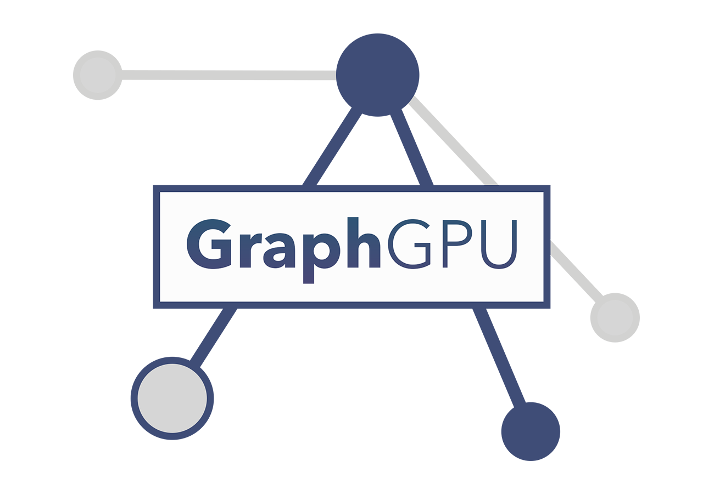

<div align="center">



<p align="center">
     <i>A WebGPU-accelerated, force-directed<br>graph visualization library for the browser</i> 
     <br><br>
     
     
     
</p>
</div>

---

<!--ts-->

- [What does this do?](#what-does-this-do)
- [How do I use it?](#how-do-i-use-it)
- [Features](#features)
- [API Reference](#api-reference)
- [Physics Engine](#physics-engine)
- [Performance](#performance)
- [Demo](#demo)
- [Architecture](#architecture)
- [Contributing](#contributing)
- [License](#license)

<!--te-->

---

### What does this do?

**GraphGPU** is a hardware-accelerated graph visualization library. Rendering is powered entirely by WebGPU — nodes, edges, selection halos, and labels all go through GPU pipelines. The physics simulation (force-directed layout) runs on either CPU or GPU compute shaders, with a  model featuring gravitational repulsion, Hooke's law springs, central gravity, and proper velocity integration.

> [!NOTE]
> WebGPU is supported in Chrome 113+, Edge 113+, and Firefox Nightly. Safari has experimental support behind a flag. GraphGPU shows a fallback message on unsupported browsers.

### How do I use it?

```typescript
import { GraphGPU } from 'graphgpu';

const g = new GraphGPU({
    canvas: '#my-canvas',
    nodeSize: 8,
    edgeOpacity: 0.8,
    palette: 'vibrant',
});

await g.init();

const alice = g.put('person', { name: 'Alice', role: 'engineer' });
const bob   = g.put('person', { name: 'Bob', role: 'designer' });
const proj  = g.put('project', { name: 'GraphGPU' });

g.link(alice, 'worksOn', proj);
g.link(bob, 'worksOn', proj);
g.link(alice, 'knows', bob);

g.startLayout();
setTimeout(() => g.fitView(), 2000);
```

> [!TIP]
> Don't want to use a bundler? Grab `graphgpu.standalone.js` or `graphgpu.standalone.min.js` straight from the [latest release](https://github.com/drkameleon/GraphGPU/releases/latest) and drop it into a script tag:
> ```html
> <script src="graphgpu.standalone.min.js"></script>
> <script>
>     const g = new GraphGPU.GraphGPU({ canvas: '#my-canvas' });
> </script>
> ```

### Features

- **WebGPU-native rendering** — instanced draw calls, MSAA, SDF circles for nodes, anti-aliased edge quads
- **Render on demand** — frames are only drawn when something changes: an idle graph costs nothing
- **Physics** — gravitational repulsion, Hooke spring edges, central gravity, viscous damping
- **Dual layout engines** — CPU force layout with Barnes-Hut O(n log n) repulsion, GPU compute shaders for large graphs (writing straight into the render buffers, no per-frame copies)
- **Animated mode** — live physics simulation with interactive drag (pinned nodes, elastic rebalancing)
- **8 built-in palettes** — `default`, `vibrant`, `pastel`, `earthy`, `inferno`, `playful`, `viridis`, `rainbow`
- **Full interactivity** — pan, zoom, drag, select, multi-select, hover (mouse, touch & pen), node & edge events, spatially indexed picking
- **Canvas2D label overlay** — auto-sizing, truncation, contrast-adaptive text color
- **Contrast-adaptive selection halos** — lighter ring on dark backgrounds, darker on light, always the node's own color
- **Tag-based coloring** — nodes and edges auto-color by tag, palette-switchable at runtime
- **SoA data layout** — Structure-of-Arrays for cache-friendly access on large graphs
- **Robust** — recovers from GPU device loss, follows canvas size changes automatically, works in hidden/zero-size containers

### API Reference

#### Constructor

```typescript
new GraphGPU({
    canvas: string | HTMLCanvasElement,
    nodeSize?: number,          // default: 6
    edgeOpacity?: number,       // default: 0.12
    palette?: string | Palette, // default: 'default'
    background?: ColorInput,    // default: [0.02, 0.02, 0.04, 1]
    antialias?: boolean,        // default: true
    pixelRatio?: number,        // default: devicePixelRatio
    maxNodes?: number,          // initial capacity (grows automatically), default: 4096
    maxEdges?: number,          // initial capacity (grows automatically), default: 8192
    autoResize?: boolean,       // follow canvas size changes, default: true
    onWebGPUUnavailable?: () => void,
    onDeviceLost?: (info) => void,  // the renderer recovers by itself
})
```

#### Graph operations

| Method | Description |
|--------|-------------|
| `put(tag, properties?)` | Add a node with a tag and optional properties |
| `link(source, tag, target)` | Add an edge (supports arrays for batch linking) |
| `unput(nodeId)` | Remove a node and its connected edges |
| `unlink(edgeId)` | Remove an edge |

#### Layout

| Method | Description |
|--------|-------------|
| `startLayout(opts?)` | Start CPU force-directed layout |
| `stopLayout()` | Stop the running layout |
| `stepLayout(n?)` | Run N layout steps synchronously (useful for pre-stabilization) |
| `startGPULayout(opts?)` | Start GPU compute layout (falls back to CPU if unavailable); stops by itself once settled |
| `stopGPULayout()` | Stop and destroy GPU layout resources |
| `setAnimated(bool)` | Enable live physics mode (layout never auto-stops) |
| `pinNode(nodeId)` | Pin a node (excluded from physics, position set manually) |
| `unpinNode(nodeId)` | Unpin a node (rejoin physics simulation) |
| `fitView(padding?)` | Fit camera to show all nodes |
| `resetPositions()` | Randomize all node positions |
| `resize()` | Re-read the canvas size (automatic unless `autoResize: false`) |

#### Appearance

| Method | Description |
|--------|-------------|
| `setPalette(name)` | Switch color palette (recolors nodes AND edges) |
| `setBackground(rgba)` | Change background color |
| `setNodeSize(size)` | Change node size at runtime |
| `setEdgeOpacity(opacity)` | Change edge opacity at runtime |
| `setLabelsVisible(bool)` | Show or hide all labels (node + edge) |
| `getTagColors()` | Get current tag→color assignments |
| `requestRender()` | Redraw after changes the library can't detect (e.g. editing raw buffers) |
| `getFps()` | Frames drawn per second (0 while idle) |

#### Interaction

| Method | Description |
|--------|-------------|
| `setSelectionEnabled(bool)` | Toggle node selection |
| `setMultiSelectEnabled(bool)` | Toggle always-on multi-select |
| `interaction: { lasso: true }` | Box selection: shift-drag on empty canvas selects the nodes inside |
| `on(event, handler)` | Listen for events |
| `off(event, handler)` | Remove listener |

#### Events

`node:click` · `node:select` · `node:deselect` · `node:hover` · `node:hoverout` · `node:drag` · `node:dragstart` · `node:dragend` · `node:dblclick` · `edge:click` · `edge:hover` · `edge:hoverout` · `canvas:click` · `canvas:pan` · `canvas:zoom`

`layout:start` · `layout:tick` (`{ iteration, energy }`) · `layout:stop` · `render:frame` (render stats: `fps`, `frameTime`, `nodeCount`, `edgeCount`, ...)

```typescript
g.on('layout:stop', () => g.fitView());
g.on('render:frame', (e) => console.log(e.target.fps));
```

### Physics Engine

The layout simulation is modeled after [vis.js network](https://visjs.github.io/vis-network/docs/network/physics.html), with three force solvers running each tick:

| Force | Formula | Description |
|-------|---------|-------------|
| **Repulsion** | `F = G / dist²` | Barnes-Hut approximation (O(n log n) quadtree); falls back to brute-force when θ=0 |
| **Springs** | `F = k × (L - dist) / dist` | Hooke's law along edges with rest length L |
| **Central gravity** | `F = g / dist` | Pull toward origin to prevent drift |

Velocity integration uses viscous damping: `a = (F - damping × v) / mass`, then `v += a × dt`, `pos += v × dt`.

```typescript
// All physics parameters are tunable:
g.startLayout({
    gravitationalConstant: -0.25,  // negative = repulsive
    barnesHutTheta: 0.3,           // 0 = exact O(n²), higher = faster approximation
    springLength: 0.2,             // edge rest length
    springConstant: 0.06,          // spring stiffness
    centralGravity: 0.012,         // pull toward center
    damping: 0.18,                 // velocity friction
    timestep: 0.35,                // integration step
    maxVelocity: 0.06,             // velocity clamp
});
```

> [!TIP]
> **Animated mode** gives you vis.js-style interactive physics. When enabled, the layout runs continuously and dragging a node pins it while the rest of the graph reacts elastically:
> ```typescript
> g.setAnimated(true);
> // Now drag any node — connected nodes will follow with spring physics!
> ```

> [!NOTE]
> The CPU layout uses Barnes-Hut quadtree approximation for O(n log n) repulsion. For exact (but slower) O(n²) computation, set `barnesHutTheta: 0`. The GPU layout runs the same physics model on compute shaders: exact all-pairs repulsion tiled through workgroup memory, and race-free springs (every node sums its own, from a per-node edge list).

### Performance

What keeps it fast, frame after frame:

- **Nothing is drawn unless something changed** (camera, graph, selection, settings)
- **Edges never get re-uploaded when nodes move**: they're a static list of endpoint ids, and the edge shader reads node positions straight from the GPU buffer the nodes are drawn from
- **Moving nodes only uploads positions** (8 bytes per node); colors, sizes and selection only when they change
- **The GPU layout writes into that same buffer**: no per-frame copies between GPU and CPU, and frames never wait on the GPU (the CPU copy, for picking and labels, is refreshed in the background)
- **Labels** are culled, measured once and overlap-tested through a spatial grid, with no per-frame allocations
- **Picking** goes through a spatial grid, rebuilt only when nodes change
- **Graph edits** are O(1) (removing a node: O(degree)); the adjacency index is built on demand

Every PR is benchmarked against its base in CI (CPU-side costs, with a fake GPU device), and runs a smoke test on a real WebGPU implementation (shader compilation, validation, pixels, layout physics against a CPU reference). A few numbers from that CI, before → after:

| | before | after |
|---|---:|---:|
| Frame after nodes moved (100k nodes / 200k edges) | 2.86 ms | 24 µs |
| Label overlay (10k nodes / 20k edges) | 141 ms | 18 ms |
| Removing 2k of 4k nodes | 85 ms | 1.1 ms |
| 1000 hit tests (100k nodes) | 1.17 s | 14 ms |

### Demo

The `demo/` folder contains a **cinema graph** (50+ nodes, 80+ edges) built with Vue 3 + TypeScript + SCSS:

```bash
cd demo
npm install
npm run dev
```

Features light/dark theme toggle, palette switching, node editing/deletion, animated physics mode, a live settings panel (node size, edge opacity, labels, all physics parameters), and a status bar with live node properties.

To see how it scales on your GPU, use the **stress test** button, or open the demo with a graph size in the URL:

```
?nodes=100000&edges=300000&layout=gpu
```

`nodes` and `edges` set the random graph's size (edges default to 3× the nodes), `layout=gpu` runs the force layout on the GPU (default: `cpu`). An FPS counter can be toggled in the settings.

### Architecture

```
src/
    index.ts              # Public API (GraphGPU class)
    core/
        Graph.ts          # SoA graph data structure
        Camera.ts         # 2D camera with pan/zoom/fit
        Renderer.ts       # WebGPU render pipeline + Canvas2D labels
    shaders/
        index.ts          # WGSL vertex/fragment/compute shaders
    interaction/
        Controls.ts       # Pointer input: pan, zoom, pinch, drag, picking, events
        SpatialIndex.ts   # Uniform grid for node picking
    layout/
        ForceLayout.ts    # CPU force-directed layout (Barnes-Hut)
        GPUForceLayout.ts # GPU compute force layout (2 passes per step, shared buffers)
        QuadTree.ts       # Barnes-Hut quadtree for O(n log n) repulsion
    utils/
        color.ts          # Color parsing (hex, rgb)
        palette.ts        # 8 built-in color palettes
    types/
        index.ts          # TypeScript type definitions
tests/                    # Unit tests (vitest, happy-dom, fake GPU device)
    gpu/smoke.ts          # Real-GPU smoke test (Deno WebGPU)
bench/                    # Benchmarks (tinybench) + base-vs-head comparison
```

### Contributing

Anything you notice or want to suggest, just [open an issue](https://github.com/drkameleon/GraphGPU/issues).
Want to contribute code? You are 100% welcome too! Just make a PR. 🚀

To run the test suite:

```bash
npm install
npm test            # single run
npm run test:watch  # watch mode
npm run test:gpu    # real-GPU smoke test (needs Deno)
```

And the benchmarks:

```bash
npm run bench                       # run all benchmarks
npm run bench -- --filter QuadTree  # run only matching ones
npm run bench:compare -- main       # compare your changes against main
```

Every PR touching the library is benchmarked against its base branch in CI, and the comparison shows up in the run summary.

<hr/>

### License

MIT License

Copyright (c) 2026 Yanis Zafirópulos

Permission is hereby granted, free of charge, to any person obtaining a copy
of this software and associated documentation files (the "Software"), to deal
in the Software without restriction, including without limitation the rights
to use, copy, modify, merge, publish, distribute, sublicense, and/or sell
copies of the Software, and to permit persons to whom the Software is
furnished to do so, subject to the following conditions:

The above copyright notice and this permission notice shall be included in all
copies or substantial portions of the Software.

THE SOFTWARE IS PROVIDED "AS IS", WITHOUT WARRANTY OF ANY KIND, EXPRESS OR
IMPLIED, INCLUDING BUT NOT LIMITED TO THE WARRANTIES OF MERCHANTABILITY,
FITNESS FOR A PARTICULAR PURPOSE AND NONINFRINGEMENT. IN NO EVENT SHALL THE
AUTHORS OR COPYRIGHT HOLDERS BE LIABLE FOR ANY CLAIM, DAMAGES OR OTHER
LIABILITY, WHETHER IN AN ACTION OF CONTRACT, TORT OR OTHERWISE, ARISING FROM,
OUT OF OR IN CONNECTION WITH THE SOFTWARE OR THE USE OR OTHER DEALINGS IN THE
SOFTWARE.